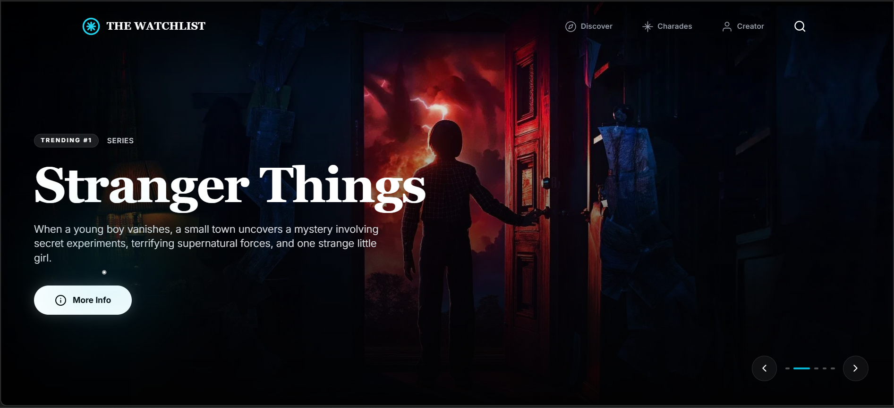
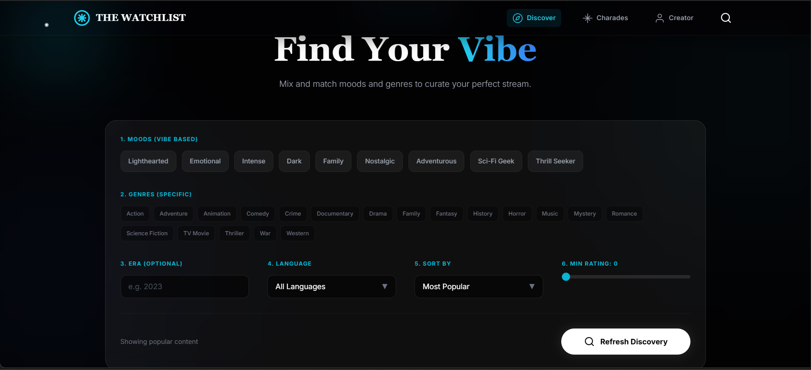
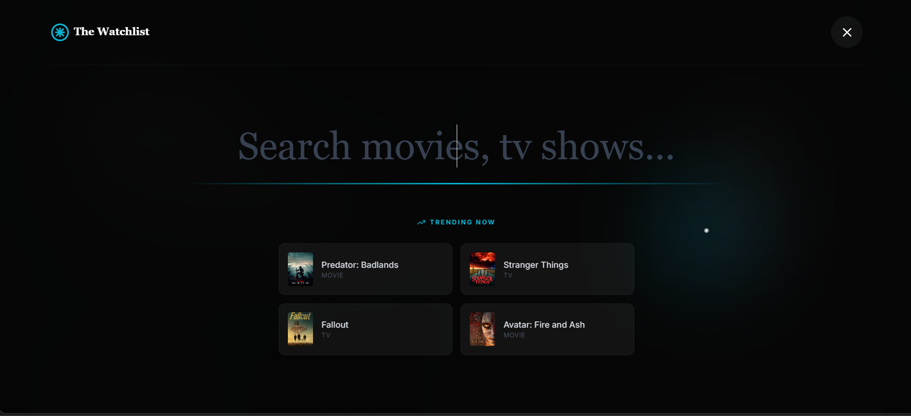
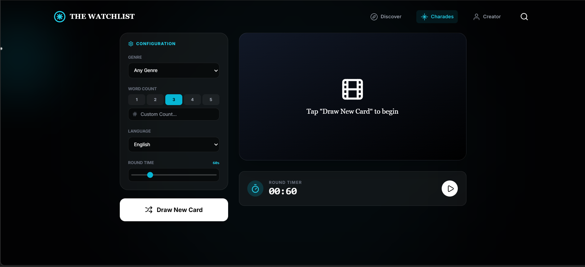

# The Watchlist

An ultra-cinematic TMDB explorer built for late-night scrolling: bold typography, motion-first UI, and a set of playful utilities (Mood Recommender + Charades) that make discovery feel like a trailer.

---

## Table of Contents

- Overview
- Features
- Live Demo / Preview
- Screenshots
- Tech Stack
- Project Structure
- Routes
- Environment Variables
- Local Development
- Production Build
- Deployment Notes
- Troubleshooting
- Data & Attribution
- Creator

---

## Overview

**The Watchlist** is a single-page React app powered by TMDB. It focuses on *vibe* and *velocity*: quick discovery, smooth transitions, and a layout that reads like a film poster wall.

Whether you want something trending right now, a random charades prompt for game night, or a mood-based pick when your brain is done choosing—this app is built to keep you watching.

---

## Features

- **Your Watchlist**: save any film or series (bookmark on posters, the hero, or a title page). It's kept on your device and synced across tabs, alongside a **Recently viewed** history.
- **Title-card hero**: today's trending titles with in-app trailer playback and a chapter strip that shows when the next slide arrives. Swipe on touch, and it pauses on hover or when hidden.
- **Search palette**: press `/` or `Ctrl/⌘ K`. Arrow-key navigation, recent searches, and trending suggestions.
- **Discover**: plain-language mood cards, genres, eras, and rating thresholds, with results that update live and a real result count.
- **Charades**: cards are drawn face-down so only the actor sees them. Revealing starts the round timer and shows letter counts per word.
- **Editorial title pages**: synopsis, key credits, cast strip, expandable reviews, a facts sidebar, and "More like this".
- **Works everywhere**: phone bottom tab bar, fluid layout from 320px to ultrawide, low-power mode for weak devices, and offline support.

---

## Live Demo / Preview

- Live: https://project-watchlist.netlify.app/
- Repo: https://github.com/sharmaram25/The-Watchlist
- Local dev: `npm run dev`
- Local preview: `npm run preview`

---

## Screenshots

Latest captures:






---

## Tech Stack

- **React 19**
- **TypeScript**
- **Vite**
- **React Router**
- **Framer Motion**
- **Lucide Icons**

---

## Project Structure

High-level map:

- `App.tsx` — Router + layout shell
- `pages/` — Route pages (Home, Details, Recommender, Charades, etc.)
- `components/` — UI building blocks (Navbar, MovieCard, CustomCursor, Footer)
- `services/` — Resilient TMDB transport (`http.ts`) and typed API helpers (`tmdbService.ts`)
- `hooks/` — Data fetching (`useQuery`), in-view detection, scroll lock, document title
- `lib/` — Device capability detection (`perf.ts`) and responsive image helpers (`images.ts`)
- `netlify/functions/tmdb.mjs` — Server-side TMDB proxy
- `public/sw.js` — Service worker (offline shell + image cache)
- `constants.ts` — Shared constants (image base URLs, mood/genre mapping)
- `types.ts` — Shared TypeScript types

---

## Routes

Core routes:

- `/` — Home (discovery/trending)
- `/recommender` — Mood recommender
- `/charades` — Charades tool
- `/about` — Creator page
- `/details/:type/:id` — Details page (`type` is `movie` or `tv`)
- `/category/:category` — Category collections

---

## Environment Variables

| Variable | Where | Purpose |
| --- | --- | --- |
| `TMDB_API_KEY` | Netlify site settings / `.env.local` | **Recommended.** Server-side key used by the proxy function. Never shipped to the browser. |
| `TMDB_READ_TOKEN` | Netlify site settings / `.env.local` | Optional alternative to `TMDB_API_KEY` (TMDB v4 read access token). |
| `VITE_USE_TMDB_PROXY` | build env | `true` (default) routes calls through the proxy first. |
| `VITE_TMDB_API_KEY` | build env | Optional client-side fallback key. It is visible to anyone who opens the bundle, so use it only as a backup. |

```bash
# .env.local
TMDB_API_KEY=YOUR_TMDB_API_KEY
VITE_USE_TMDB_PROXY=true
```

`npm run dev` and `npm run preview` run the same proxy function locally (see `vite.config.ts`), so local development behaves exactly like production. No netlify-cli is needed.

---

## How the app stays up

TMDB is blocked or flaky on some ISPs (notably `api.themoviedb.org`), and serverless functions have cold starts. `services/http.ts` makes every request resilient:

- **Multiple routes**: Netlify proxy → `api.themoviedb.org` → `api.tmdb.org` (an official alias that works where the main domain is blocked). The proxy itself also fails over between both hosts.
- **Hedged requests**: if a route hasn't answered in 2.5s, the next one is raced in parallel. The winning route is remembered.
- **Retries and timeouts**: transient errors (network, 429, 5xx) back off and retry, and every attempt has a hard timeout.
- **Caching**: in-memory + persistent (Cache API) with per-endpoint freshness. If every route fails, the last good copy is shown with a small "showing saved results" notice instead of an error screen.
- **Offline**: a service worker (`public/sw.js`) caches the app shell, build assets, fonts and posters, so the app opens and browses previously seen content offline.
- **Images**: if `image.tmdb.org` fails for a visitor, images retry through Netlify's Image CDN.
- **Isolation**: each home rail loads (and fails) independently, and route-level error boundaries keep one broken page from blanking the app.

## Performance on every device

- Route-level code splitting, with the animation engine loaded asynchronously, React in a long-cached vendor chunk, and idle-time prefetch of other routes.
- Responsive `srcset` for every TMDB image (phones never download `original`-size 4K backdrops).
- Below-the-fold rails fetch only when they approach the viewport, and use `content-visibility` to skip offscreen rendering.
- **Low-power mode** (`lib/perf.ts`): devices with few cores, little memory, Data Saver, or a measured frame rate under ~35fps automatically drop backdrop blur, parallax, the custom cursor and transform animations. The design stays the same. Override with `?perf=lite`, `?perf=full` or `?perf=auto`.
- Respects `prefers-reduced-motion`. Hover effects apply only on devices that can hover. The custom cursor only runs with a mouse, and it sleeps when idle.
- Fluid layout: a fluid gutter, a `clamp()` type scale, and auto-fitting grids from 320px phones to ultrawide monitors, with safe-area insets for notched phones.

---

## Local Development

```bash
npm install
npm run dev        # http://localhost:3000
npm run typecheck  # TypeScript, no emit
```

## Production Build

```bash
npm run build
npm run preview    # serves dist/ with the local proxy on http://localhost:4173
```

---

## Deployment Notes

- **Netlify** (recommended): `netlify.toml` is included. Set `TMDB_API_KEY` in *Site settings → Environment variables*, then remove `VITE_TMDB_API_KEY` / `VITE_USE_TMDB_PROXY=false` if they were set. The proxy lives in `netlify/functions/tmdb.mjs`.
- **Other static hosts**: the app works with only `VITE_TMDB_API_KEY` (direct mode with automatic host failover), but the key is then public.

---

## Troubleshooting

- **"Connection Interrupted" modal**: it only appears when every route failed *and* nothing is cached. Check that `TMDB_API_KEY` is set on Netlify and that `/.netlify/functions/tmdb?endpoint=/trending/all/day` returns JSON.
- **Proxy returns 404 HTML**: the function isn't deployed. Make sure `netlify/functions/tmdb.mjs` exists and redeploy.
- **Stale UI after a deploy**: the service worker always fetches fresh HTML when online, so a normal reload picks up the new version.

---

## Data & Attribution

This product uses the **TMDB API** but is not endorsed or certified by TMDB.

---

## 👨‍💻 **Meet The Creator**


### **Ram Sharma**
*Full-Stack Developer & Cinema Enthusiast*

**🚀 Passionate about creating exceptional user experiences**  
**🎬 Combining technology with entertainment magic**  
**✨ Building the future of movie discovery**

<div align="center">

[](https://github.com/sharmaram25)
[](https://www.linkedin.com/in/ram-sharma-20rs02)
[](https://www.instagram.com/ramsharma.25)
[](mailto:sharmaram2504@gmail.com)


- Portfolio: https://portfolio-ram-sharma.netlify.app/
- Email: sharmaram2504@gmail.com

</div>

---

## 🌟 **Show Your Support**

If The WatchList has enhanced your movie discovery journey, please consider:

<div align="center">

**⭐ Star this repository**  
**🐛 Report issues to help us improve**  
**💡 Suggest features in discussions**  
**📢 Share with fellow movie lovers**  
**🤝 Contribute to the codebase**

</div>


---

<div align="center">

### 🎬 **Happy Watching! 🍿**


**Built with ❤️ for movie and TV show enthusiasts everywhere**

*"Every great film begins with a single frame. Every great app begins with a single commit."*  
**— Ram Sharma, Creator of The WatchList**

---

**🌟 Made with passion, precision, and popcorn 🍿**

</div>
